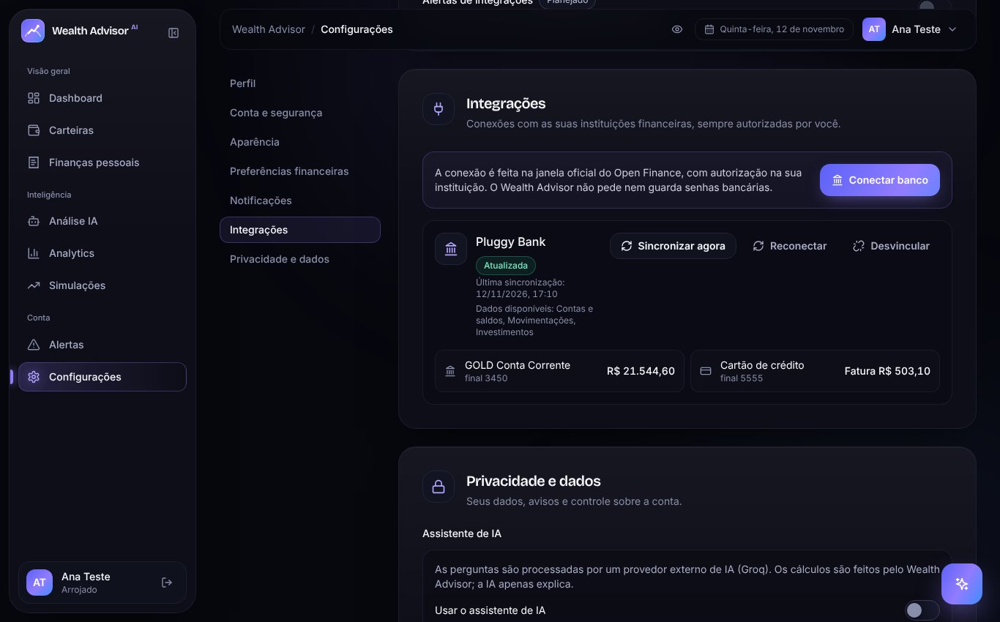
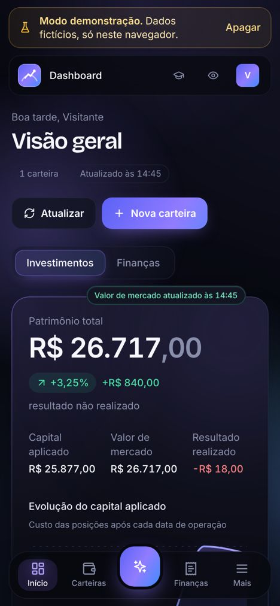

<div align="center">

# AI Wealth Advisor

**Organize seu dinheiro, acompanhe seus investimentos e planeje suas metas com mais clareza.**

Plataforma acadêmica de gestão financeira pessoal, acompanhamento de investimentos e apoio à compreensão dos dados com inteligência artificial.

[**Acessar o sistema**](https://ai-wealth-advisor-sable.vercel.app) · [**Ver a documentação técnica da Fase 9**](docs/FASE9.md) · [**Quadro do Trello**](https://trello.com/b/3cQiM4V2/meu-quadro-do-trello)

</div>


> **Projeto acadêmico.** O AI Wealth Advisor não é banco nem corretora, não movimenta dinheiro, não executa ordens de compra/venda e não oferece recomendações profissionais individualizadas. As simulações são hipotéticas.

## Sobre o projeto

O AI Wealth Advisor reúne recursos para acompanhar **receitas, despesas, orçamentos, metas e investimentos**. O usuário pode registrar movimentações manualmente, conectar instituições financeiras compatíveis por meio da Pluggy e consultar indicadores e explicações com IA.

O projeto foi desenvolvido para a disciplina **Análise e Projeto de Sistemas II**, da **Universidade Cruzeiro do Sul**, em 2026. A versão atual evoluiu da arquitetura inicial em Go para uma aplicação React/TypeScript com backend serverless, Supabase PostgreSQL e integrações externas.

## Funcionalidades implementadas

| Módulo | O que oferece |
|---|---|
| **Finanças pessoais** | Registro de receitas e despesas, categorias, orçamentos mensais e visão do saldo do período. |
| **Metas financeiras** | Metas com valor-alvo, prazo, aportes, retiradas e acompanhamento do progresso. |
| **Carteiras manuais** | Cadastro de carteiras e ativos, registro informativo de compras e vendas, posições, quantidade, preço médio e capital aplicado. |
| **Open Finance** | Conexão via Pluggy, importação de contas, movimentações e investimentos disponibilizados pelas instituições, sincronização e desvinculação. |
| **Dashboard e Analytics** | Indicadores, gráficos de receitas e despesas, gastos por categoria e informações de investimentos. |
| **Simulações** | Cenários hipotéticos com valor inicial, aportes, prazo e taxa de rendimento. |
| **Análise por IA** | Diagnóstico e chat financeiro com Groq, com base nos dados que o sistema disponibiliza e nas permissões do usuário. |
| **Cotações e alertas** | Consulta de preços disponíveis via brapi e alertas ligados a condições financeiras verificadas pelo sistema. |
| **Conta e interface** | Login, perfil, preferências, tutoriais, tema e experiência adaptada a desktop e dispositivos móveis. |

**Importante:** carteiras cadastradas manualmente e investimentos importados dos bancos são exibidos de forma separada. Isso evita somar posições que podem representar os mesmos investimentos. Cotações indisponíveis são informadas, sem inventar preços.

## Capturas de tela

| Dashboard | Finanças pessoais | Análise por IA |
|---|---|---|
|  |  |  |

| Integrações | Experiência mobile |
|---|---|
|  |  |

*As imagens são ilustrativas da interface e podem representar cenários de demonstração. Não representam retornos financeiros garantidos.*

## Tecnologias

| Camada | Tecnologias |
|---|---|
| **Frontend** | React 18, TypeScript, Vite, Tailwind CSS, Motion e Recharts |
| **Backend atual** | Funções serverless em TypeScript na Vercel (`frontend/api` e `frontend/server`) |
| **Persistência e identidade** | Supabase PostgreSQL, Supabase Auth, políticas de segurança RLS |
| **Serviços financeiros** | Pluggy (Open Finance), brapi (cotações) |
| **Inteligência artificial** | Groq API |
| **Versionamento e hospedagem** | Git, GitHub, Vercel |

O diretório `backend/` contém uma implementação anterior em **Go**, mantida como histórico e **não utilizada no deploy atual**. Arquivos de infraestrutura Docker também refletem a arquitetura anterior. Python não faz parte do backend de produção.

## Arquitetura atual

```text
Navegador (React + TypeScript)
  ├── Supabase Auth ──────────────── autenticação
  ├── Supabase PostgreSQL ────────── dados do usuário com RLS
  └── Vercel Serverless Functions
        ├── Pluggy ──────────────── conexão e importação bancária
        ├── brapi ───────────────── cotações disponíveis
        └── Groq ───────────────── assistente de IA
```

As funções serverless tratam operações que dependem de credenciais privadas. O frontend não deve receber chaves secretas. As regras de acesso a dados pessoais são aplicadas pelo Supabase, com RLS no banco de dados.

## Estrutura do repositório

```text
ai-wealth-advisor/
├── frontend/
│   ├── src/                 # páginas, componentes, domínio e serviços
│   ├── api/                 # entrada das funções Vercel
│   ├── server/              # implementação do backend serverless
│   ├── public/              # recursos estáticos
│   ├── package.json
│   └── vercel.json
├── supabase/
│   ├── migrations/          # evolução do esquema PostgreSQL
│   └── tests/               # testes SQL de isolamento
├── docs/                   # diagramas, documentação e capturas
├── backend/                # implementação Go legada (histórico)
├── infrastructure/         # configuração de infraestrutura legada
└── README.md
```

## Executar localmente

**Pré-requisito:** Node.js 20 ou superior, com npm.

```bash
git clone https://github.com/pkeddits/ai-wealth-advisor.git
cd ai-wealth-advisor/frontend
npm ci
npm run dev
```

Por padrão, o aplicativo pode ser executado no modo de demonstração com dados fictícios. Acesse `http://localhost:5173`.

Para configurar autenticação real, integrações externas ou serviços de IA, crie **`frontend/.env.local`** a partir de **`frontend/.env.example`** e configure somente as credenciais necessárias. O arquivo `.env.local` é privado e não deve ser enviado ao GitHub.

### Modos de funcionamento

- `VITE_APP_MODE=demo`: demonstração local com dados fictícios.
- `VITE_APP_MODE=supabase`: usuários autenticados e dados persistidos no Supabase.
- O modo `api` pertence à arquitetura legada e não é utilizado na versão publicada.

### Segurança das variáveis de ambiente

Variáveis cujo nome começa com `VITE_` são incorporadas ao JavaScript do navegador e devem conter **apenas valores publicáveis**. Chaves privadas (`SUPABASE_SECRET_KEY`, `PLUGGY_CLIENT_SECRET`, `GROQ_API_KEY`, `BRAPI_API_KEY` e similares) devem permanecer nas configurações privadas do servidor.

Consulte `frontend/.env.example` para a lista de variáveis esperadas. **Nunca copie seus valores reais para o README, commits ou capturas.**

## Verificações disponíveis

Na pasta `frontend/`:

```bash
npm run type-check
npm run build
npm run check:domain
npm run check:quotes
npm run check:openfinance
npm run check:planning
npm run check:functions
npm run check:sync
```

Os scripts acima verificam aspectos específicos do projeto. Os testes SQL de políticas de acesso estão em `supabase/tests/` e devem ser executados em ambiente de teste, conforme sua finalidade. A existência dos scripts não equivale a afirmar que todos passaram na execução mais recente.

## Implantação

A aplicação pública está em **https://ai-wealth-advisor-sable.vercel.app**.

Na Vercel, o projeto utiliza **Root Directory = `frontend`**, framework Vite, comando de build `npm run build` e diretório de saída `dist`. As funções em `frontend/api/` utilizam as variáveis privadas configuradas no ambiente do projeto.

## Limitações conhecidas e próximos passos

- Não realiza ordens reais de compra e venda nem transferências bancárias.
- Investimentos manuais e importados não possuem conciliação automática.
- A cobertura de instituições, produtos e movimentações depende da integração bancária.
- Algumas cotações podem não estar disponíveis, impedindo um cálculo completo de valor de mercado.
- A renda fixa não possui, nesta versão, tratamento contratual completo para todas as modalidades e indexadores.
- Projeções são cenários hipotéticos, não garantias de rentabilidade.
- A IA pode ficar temporariamente indisponível por limites ou falhas do provedor.
- O produto ainda pode melhorar a clareza dos formulários de investimento, conforme avaliação qualitativa de usabilidade.

## Documentação e evolução

- [Histórico técnico da Fase 9](docs/FASE9.md)
- **Documentação acadêmica final e apresentação:** serão adicionadas à pasta `docs/entrega-final/` após finalizadas e conferidas.
- O histórico das fases anteriores está preservado em `docs/`.

## Equipe

- Caio Rocha Amorim
- Felipe Pereira Lima
- Gabriel Augusto
- Kauã Steter
- Victor Hugo dos Santos

**Professor:** Silvio Rogerio de Lucia
**Disciplina:** Análise e Projeto de Sistemas II
**Instituição:** Universidade Cruzeiro do Sul
**Ano:** 2026

---

<div align="center">AI Wealth Advisor · Projeto acadêmico · 2026</div>
