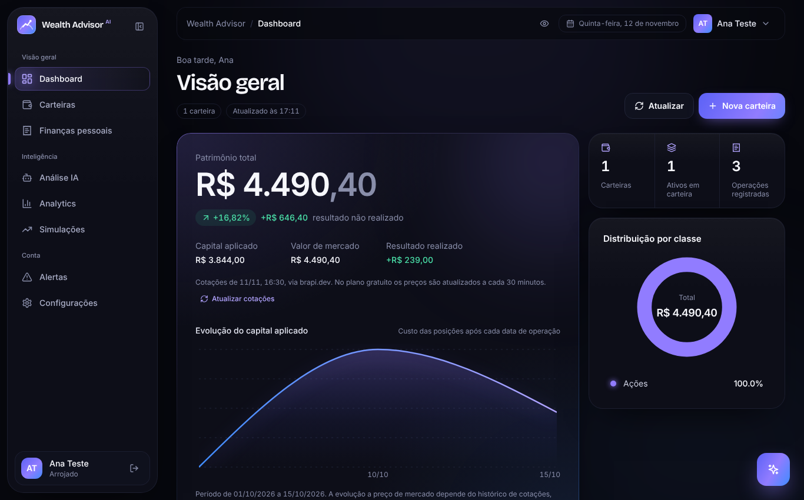
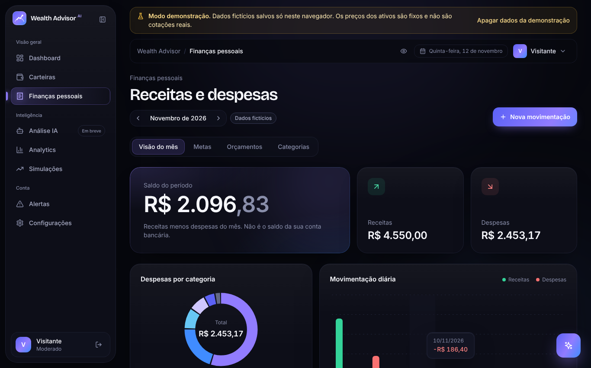
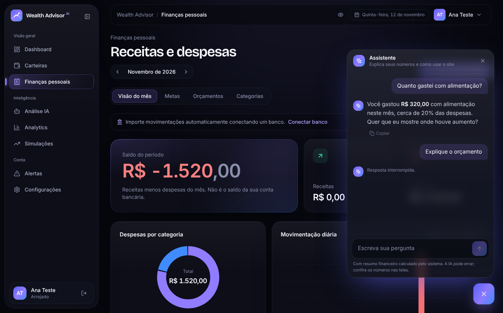

# AI Wealth Advisor

Plataforma acadêmica de organização financeira e acompanhamento de investimentos, desenvolvida para a
disciplina **Análise e Desenvolvimento de Sistemas II** (2026). Reúne carteiras de investimento,
finanças pessoais, conexão bancária pelo Open Finance e um assistente de IA que explica os números
calculados pelo sistema.

> Projeto acadêmico. Não é instituição financeira, não executa ordens e não oferece recomendação de investimento.


## Funcionalidades

| Área | O que faz |
|---|---|
| Carteiras | Compras e vendas registradas pelo usuário, preço médio pelo custo médio, capital aplicado, valor de mercado (cotações brapi.dev), resultado realizado e não realizado |
| Finanças pessoais | Receitas e despesas manuais e importadas, categorias (inclusive personalizadas), metas com aportes e retiradas, orçamentos mensais |
| Open Finance | Conexão pela Pluggy (widget oficial), importação de contas, movimentações e investimentos, sincronização sem duplicar, reclassificação de importados |
| Inteligência | Análise IA e chatbot (Groq) com streaming, Analytics, Simulações com juros compostos, Alertas por regras |
| Conta | Perfil, segurança, aparência (tema, densidade, animações), preferências, privacidade e consentimento da IA |
| Demonstração | Modo com dados fictícios no navegador, sem serviços externos |

| Dashboard | Finanças | Assistente |
|---|---|---|
|  |  |  |

## Arquitetura

```
frontend/              React 18 + Vite + TypeScript + Tailwind (SPA)
  src/domain/          Cálculos determinísticos (posições, finanças, metas, simulações, alertas)
  src/services/        Acesso a dados por modo: demo (localStorage) | supabase | api (legado)
  server/              Lógica das funções de servidor (cotações, Pluggy, IA), testável sem rede
  api/                 Vercel Functions que chamam server/ (mesmo código no npm run dev)
supabase/migrations/   Esquema PostgreSQL com Row Level Security
supabase/tests/        Testes SQL de isolamento entre usuários
backend/               Backend Go original (não compila; mantido apenas como histórico)
```

- **Dados e autenticação:** Supabase (PostgreSQL + Auth). Cada tabela privada tem RLS; o navegador usa
  apenas a chave publicável.
- **Servidor:** Vercel Functions em TypeScript para o que exige segredo (brapi, Pluggy, Groq). Toda
  função valida a sessão do Supabase e deriva o usuário do token, nunca do corpo da requisição.
- **IA:** a IA recebe um resumo calculado pelo sistema (sem descrições de transações, contas ou
  documentos), somente com consentimento do usuário. Ela explica; não calcula nem executa ações.
- **Investimentos manuais e importados** ficam separados: podem representar os mesmos ativos.

## Executar localmente

Requisitos: Node.js 20 ou superior.

```bash
cd frontend
cp .env.example .env.local   # ajuste as variáveis (veja abaixo)
npm ci
npm run dev                  # http://localhost:5173
```

Sem configuração nenhuma, o app roda no modo demonstração (`VITE_APP_MODE=demo`).

### Variáveis de ambiente

| Variável | Onde | Uso |
|---|---|---|
| `VITE_APP_MODE` | pública | `demo` ou `supabase` |
| `VITE_SUPABASE_URL`, `VITE_SUPABASE_PUBLISHABLE_KEY` | pública | Projeto Supabase (chave publicável `sb_publishable_...`) |
| `VITE_PLUGGY_INCLUDE_SANDBOX` | pública | `true` exibe o conector de testes no widget |
| `SUPABASE_SECRET_KEY` | **servidor** | Gravação dos dados importados pela Pluggy |
| `PLUGGY_CLIENT_ID`, `PLUGGY_CLIENT_SECRET` | **servidor** | Open Finance |
| `BRAPI_API_KEY` | **servidor** | Opcional; cotações além dos ativos de teste |
| `AI_PROVIDER`, `GROQ_API_KEY`, `GROQ_MODEL` | **servidor** | Assistente de IA |
| `AI_COMPARE_ENABLED`, `GEMINI_API_KEY`, `GEMINI_MODEL` | **servidor** | Comparação de provedores com dados sintéticos |

Variáveis de servidor **nunca** levam o prefixo `VITE_`, que as exporia no navegador.

### Banco de dados

No SQL Editor do Supabase, execute em ordem os arquivos de `supabase/migrations/` e depois os testes de
`supabase/tests/` (cada um termina com "todos os testes passaram" e desfaz os dados de teste).

## Testes

```bash
cd frontend
npm run build
npm run check:domain       # posições e finanças
npm run check:quotes       # serviço de cotações (respostas simuladas da brapi)
npm run check:openfinance  # classificação de transações importadas
npm run check:planning     # simulações, metas, orçamentos e alertas
```

Os testes de navegador e de integração com banco local usados no desenvolvimento estão descritos em
`docs/FASE*.md`.

## Publicação

Veja [docs/DEPLOY.md](docs/DEPLOY.md) (GitHub e Vercel, passo a passo).

## Limitações conhecidas

- Open Finance validado no Sandbox da Pluggy; não com bancos pessoais reais nem com duas instituições ao mesmo tempo.
- Sem conciliação automática entre investimentos manuais e importados.
- Sem histórico de cotações: não há evolução do patrimônio a preço de mercado.
- Alertas calculados ao abrir o app; não há monitoramento em segundo plano nem envio por e-mail.
- O limite de uso da IA é contado por instância da função na Vercel.
- O backend Go original não compila e não é usado.

## Equipe

Projeto da disciplina ADS II, Cruzeiro do Sul, 2026.
